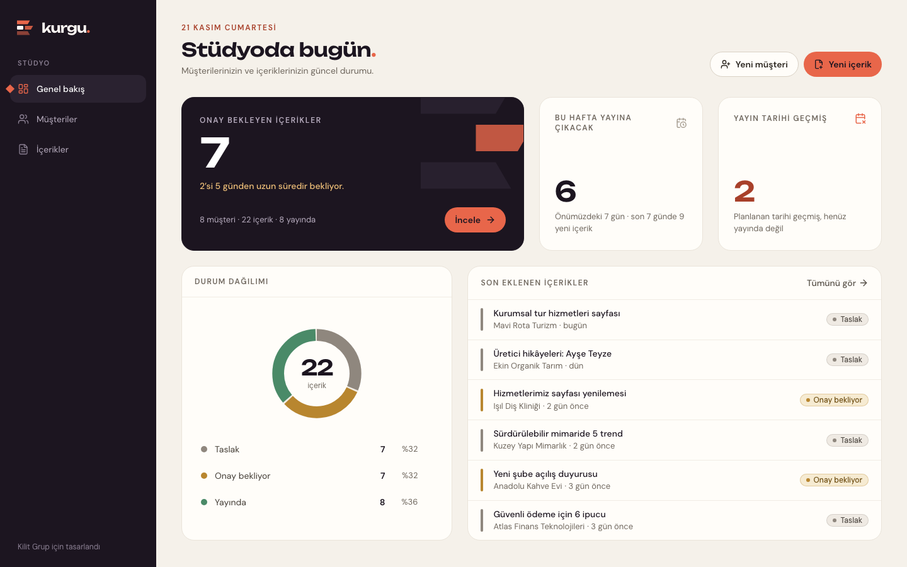

# kurgu.

Ajans hesap yöneticilerinin müşterilerini ve müşterilere ait içerikleri takip ettiği bir **müşteri ve içerik takip paneli**.



**Canlı demo:** _yayınlandığında eklenecek_

> Bu proje, **Kilit Grup Full Stack Developer teknik değerlendirmesi** kapsamında hazırlanmıştır.

## İçindekiler

- [Amaç ve kapsam](#amaç-ve-kapsam)
- [Teknolojiler](#teknolojiler)
- [Özellikler](#özellikler)
- [Yerel kurulum](#yerel-kurulum)
- [Ortam değişkenleri](#ortam-değişkenleri)
- [Docker ve PostgreSQL](#docker-ve-postgresql)
- [Prisma: migration ve seed](#prisma-migration-ve-seed)
- [Testler ve kalite kontrolleri](#testler-ve-kalite-kontrolleri)
- [API](#api)
- [Proje yapısı](#proje-yapısı)
- [Tasarım kararları](#tasarım-kararları)
- [Deployment yaklaşımı](#deployment-yaklaşımı)
- [Sonraki adımlar](#sonraki-adımlar)

## Amaç ve kapsam

Uygulama, bir ajansın içerik iş akışını tek bir yerden izlemesini sağlar:

- **Genel bakış:** Onay bekleyen içerikler (5 günden uzun bekleyenler vurgulanır), bu hafta yayına çıkacak ve yayın tarihi geçmiş içerikler, durum dağılımı ve son eklenen içerikler.
- **Müşteri yönetimi:** Ekleme, düzenleme, silme (bağlı içeriklerle birlikte, onaylı), arama, sıralama, durum dağılım çubuğu ve müşteri detayında sayfalanmış içerik listesi.
- **İçerik yönetimi:** Oluşturma, düzenleme, silme; durum sekmeleri (sayılarıyla), müşteri ve tür filtreleri, başlık araması, sıralama, listeden tek tıkla durum değiştirme ve "Geri al", durum geçmişi, planlanan yayın tarihi, platform ve önizleme.

İçerik türleri **sosyal medya gönderisi**, **blog yazısı** ve **web sayfası**; durumlar **Taslak**, **Onay bekliyor** ve **Yayında**'dır.

Kimlik doğrulama bu sürümün kapsamı dışındadır.

## Teknolojiler

| Katman | Teknoloji |
|---|---|
| Uygulama | Nuxt 3, Vue 3 (Composition API), TypeScript (strict) |
| Arayüz | Tailwind CSS 3 (design token'ları), Unbounded + DM Sans (Fontsource), Lucide ikonları |
| Backend | Nuxt Server API (Nitro) |
| Veritabanı | PostgreSQL 16 (yerelde Docker, canlıda Neon) |
| ORM | Prisma 6 |
| Doğrulama | Zod 4: ön yüz ve API aynı şemaları kullanır |
| Test | Vitest, @nuxt/test-utils |
| Kod kalitesi | ESLint (@nuxt/eslint), vue-tsc |

## Özellikler

**İçerik iş akışı**
- İçerik **ilk kez** yayına alındığında `publishedAt` otomatik doldurulur. Yayındaki içeriğin başka bir alanı güncellendiğinde mevcut tarih korunur, yayından kaldırıldığında tarih temizlenir. Bu alan istemciden gönderilemez.
- Durum, içerik detay sayfasından tek tıkla değiştirilebilir. İstek başarısız olursa seçim eski haline döner.
- Her durum değişikliği `content_status_changes` tablosuna yazılır; detay sayfasında zaman çizelgesi olarak gösterilir. `statusChangedAt` "X gündür onay bekliyor" bilgisini besler.
- Müşteri silindiğinde içerikleri de silinir (`ON DELETE CASCADE`); onay diyaloğu kaç içeriğin silineceğini yazar.

**Arama ve filtreleme**
- Arama ve filtreler URL query parametreleriyle senkronize çalışır. Sayfa yenilenince korunur, bağlantı olarak paylaşılabilir.
- Filtreler birlikte kullanılabilir (arama + durum + müşteri).
- Arama, Türkçe büyük/küçük harf farklarını tanır (ör. "TARIM" araması "Tarım"ı bulur).

**Doğrulama ve hata yönetimi**
- Ön yüz ve API aynı Zod şemalarını kullanır. Hatalar Türkçe olarak ilgili alanın altında gösterilir.
- API tutarlı bir hata biçimi döndürür: `400` hatalı istek veya filtre, `404` kayıt bulunamadı, `422` form hataları (`data.fieldErrors`).

**Kullanıcı deneyimi**
- Her ekranda skeleton yükleme, empty state, hata ve "tekrar dene" durumları vardır. İşlem sonuçları toast bildirimiyle gösterilir.
- Erişilebilir modal'lar: odak modal içinde kalır, Escape ile kapanır, kapanınca odak açan öğeye döner. Hatalı gönderimde ilk hatalı alana odaklanılır ve alan görünür alana kaydırılır.
- Mobil ve masaüstü uyumlu yerleşim: mobilde açılır menü ve kart görünümü.

## Yerel kurulum

**Gereksinimler**
- Node.js `>= 22.12`
- Docker (Docker Desktop veya Docker Engine + Compose)

```bash
# 1. Bağımlılıkları kurun (Prisma Client otomatik üretilir)
npm install

# 2. Ortam değişkenlerini hazırlayın ve şifreyi değiştirin
cp .env.example .env

# 3. PostgreSQL'i başlatın
npm run db:up

# 4. Veritabanı şemasını oluşturun ve demo verisini yükleyin
npm run db:migrate
npm run db:seed

# 5. Uygulamayı başlatın
npm run dev
```

Uygulama varsayılan olarak `http://localhost:3000` adresinde açılır.

## Ortam değişkenleri

Tüm değişkenler `.env.example` dosyasında açıklamalarıyla yer alır. `.env` dosyası Git tarafından hariç tutulur ve depoya eklenmemelidir.

| Değişken | Açıklama |
|---|---|
| `POSTGRES_USER`, `POSTGRES_PASSWORD`, `POSTGRES_DB` | Yerel Docker PostgreSQL kullanıcı adı, şifre ve veritabanı adı |
| `DATABASE_URL` | Uygulamanın (Prisma Client) kullandığı bağlantı. Canlıda Neon **pooled** bağlantısı |
| `DIRECT_URL` | Prisma Migrate'in kullandığı doğrudan bağlantı. Yerelde `DATABASE_URL` ile aynıdır, canlıda Neon **direct** bağlantısı |

`POSTGRES_PASSWORD` değerini ve iki bağlantı adresindeki şifreyi aynı, güçlü bir değerle değiştirin. Örneğin `openssl rand -hex 16` ile üretebilirsiniz.

## Docker ve PostgreSQL

`docker-compose.yml` yalnızca bu projeye ait bir PostgreSQL 16 servisi tanımlar:

| Ayar | Değer |
|---|---|
| Container | `kilit-content-panel-db` |
| Volume | `kilit_content_panel_pgdata` |
| Port | `127.0.0.1:5435` (yalnızca yerel makineden erişilebilir) |
| Sağlık kontrolü | `pg_isready` |

Varsayılan `5432` yerine `5435` portu, makinedeki diğer PostgreSQL kurulumlarıyla çakışmamak için seçilmiştir. Port değişirse `docker-compose.yml` ve `.env` dosyaları birlikte güncellenmelidir.

```bash
npm run db:up      # container'ı başlatır
npm run db:down    # container'ı durdurur (veri volume'de kalır)
```

## Prisma: migration ve seed

**Veri modeli**

- `Client` 1 — N `Content`: her içerik tam olarak bir müşteriye aittir.
- Tablolar `clients` ve `contents`; sütunlar veritabanında snake_case adlandırılır (ör. `client_id`, `published_at`).
- Enum'lar: `ContentType` (`SOCIAL_POST`, `BLOG_POST`, `WEB_PAGE`) ve `ContentStatus` (`DRAFT`, `IN_REVIEW`, `PUBLISHED`).

| Komut | Açıklama |
|---|---|
| `npm run db:migrate` | Yerelde migration oluşturur ve uygular (`prisma migrate dev`) |
| `npm run db:deploy` | Mevcut migration'ları uygular; canlı ortam için (`prisma migrate deploy`) |
| `npm run db:seed` | Demo verisini **sıfırlayıp** yeniden yükler: 8 müşteri, 22 içerik, durum geçmişi |
| `npm run db:generate` | Prisma Client'ı yeniden üretir |
| `npm run db:studio` | Prisma Studio'yu açar |

Seed tüm müşteri ve içerikleri **silip** demo verisini yeniden oluşturur; tarihler çalıştırıldığı ana göre hesaplanır (son 6 hafta, bazı içerikler 5 günden uzun süredir onayda, bazılarının yayın tarihi bu hafta ya da geçmiş). Güvenlik için yalnızca yerel veritabanında çalışır; uzak bir veritabanında `SEED_ALLOW_REMOTE=1` gerekir. Tüm firma ve kişi bilgileri kurgusaldır; e-posta adresleri ayrılmış `.example` alan adını kullanır.

## Testler ve kalite kontrolleri

| Komut | Açıklama |
|---|---|
| `npm run lint` | ESLint |
| `npm run typecheck` | vue-tsc ile tip kontrolü |
| `npm run test:unit` | Zod şemaları, `publishedAt` kuralı, arama yardımcısı ve enum uyumu |
| `npm run test:api` | API integration testleri |
| `npm test` | Tüm testler |
| `npm run build` | Production build |

**API integration testleri hakkında**
- Uygulamanın gerçek bir build'i üzerinden HTTP istekleri gönderir; yerel veritabanının çalışıyor olması gerekir (`npm run db:up`).
- Testlerin oluşturduğu kayıtlar `__api_test__` önekiyle işaretlenir ve test sonunda silinir.
- Demo verisinin test boyunca değişmediği ayrıca doğrulanır.
- Güvenlik önlemi olarak testler `DATABASE_URL` yerel veritabanını (`localhost:5435/kilit_content_panel`) göstermiyorsa çalışmayı reddeder.

## API

| Metot | Yol | Açıklama |
|---|---|---|
| `GET` | `/api/dashboard` | Onay kuyruğu, yayın takvimi metrikleri, durum sayıları, son 6 içerik |
| `GET` | `/api/clients?search=&sort=` | Müşteri listesi ve durumlara göre içerik sayıları |
| `POST` | `/api/clients` | Müşteri oluşturma |
| `GET` | `/api/clients/:id` | Müşteri detayı ve durum sayıları |
| `PATCH` | `/api/clients/:id` | Müşteri güncelleme (kısmi) |
| `DELETE` | `/api/clients/:id` | Müşteriyi içerikleriyle birlikte siler, silinen içerik sayısını döndürür |
| `GET` | `/api/industries` | Kullanılan sektörler (combobox önerileri) |
| `GET` | `/api/contents?search=&status=&type=&clientId=&sort=&page=&pageSize=` | Sayfalanmış içerik listesi ve sekme sayıları |
| `POST` | `/api/contents` | İçerik oluşturma |
| `GET` | `/api/contents/:id` | İçerik detayı ve durum geçmişi |
| `PATCH` | `/api/contents/:id` | İçerik güncelleme (kısmi) |
| `DELETE` | `/api/contents/:id` | İçerik silme |

## Proje yapısı

```
├── app.vue, error.vue          # Uygulama kökü ve hata sayfası
├── layouts/default.vue         # Sidebar, mobil menü ve içerik alanı
├── pages/                      # Genel bakış, müşteriler, içerikler (liste + detay)
├── components/
│   ├── app/                    # Marka alanı ve sidebar
│   ├── ui/                     # Ortak bileşenler (Button, Modal, FormField, EmptyState…)
│   ├── client/                 # Müşteri tablosu ve formu
│   └── content/                # İçerik tablosu, formu, durum ve tür bileşenleri
├── composables/                # Toast, focus trap, scroll lock, URL query, form hataları
├── utils/                      # Biçimlendirme, API hata mesajları, durum renkleri
├── types/api.ts                # Nitro route'larından türetilen API yanıt tipleri
├── shared/                     # Ön yüz ve sunucunun ortak kodu
│   ├── constants/              # İçerik türü ve durum sabitleri, Türkçe etiketler
│   ├── schemas/                # Zod doğrulama şemaları
│   └── utils/                  # Doğrulama ve arama yardımcıları
├── server/
│   ├── api/                    # 13 API endpoint'i
│   └── utils/                  # Prisma singleton, HTTP/hata yardımcıları, iş kuralları
├── prisma/                     # Şema, migration'lar ve seed
├── tests/
│   ├── unit/                   # Unit testler
│   └── api/                    # API integration testleri
├── docker-compose.yml          # Yerel PostgreSQL 16
└── .env.example                # Ortam değişkeni şablonu
```

Kod, değişken ve dosya adları İngilizcedir; kullanıcı arayüzü Türkçedir.

## Tasarım kararları

1. **Ana kart onay bekleyenlere ayrıldı.** Hesap yöneticisinin günlük işi, müşteriden onay bekleyen içerikleri takip etmektir. Toplam sayılar bilgi verir ama eylem gerektirmez; bu yüzden ana kart "kaç içerik bekliyor, kaçı 5 günü geçti" sorusunu yanıtlar ve tek tıkla en uzun bekleyenden sıralı listeye götürür.
2. **Filtreler URL'de tutulur.** Arama, durum, müşteri, tür, sıralama ve sayfa query parametrelerindedir. Böylece bir filtre bağlantı olarak paylaşılabilir, sayfa yenilense de korunur ve tarayıcının geri tuşu beklenen şekilde çalışır.
3. **Durum, listeden ve geri alınabilir şekilde değişir.** En sık yapılan işlem için detay sayfasına gitmek gerekmez. Yanlış tıklamanın maliyeti düşük kalsın diye her değişiklikten sonra 5 saniyelik "Geri al" sunulur; liste ve detay sayfası aynı mantığı paylaşır.
4. **Durum renkleri marka renginden ayrıdır.** Mercan yalnızca marka ve birincil eylemler içindir; Taslak / Onay bekliyor / Yayında rozet, grafik ve satır şeridinde aynı token'larla gösterilir. Mercan butonlarda beyaz yerine koyu metin kullanılır, çünkü beyaz metin WCAG AA kontrastını sağlamaz.
5. **Ön yüz ve API aynı doğrulamayı kullanır.** Zod şemaları `shared/` altındadır; telefon `+90 5XX XXX XX XX`, sektör Türkçe baş harf büyük biçimde normalize edilir. Ön yüz kullanıcıya erken geri bildirim verir, API ise tek doğruluk kaynağıdır.

## Deployment yaklaşımı

Hedef ortam **Vercel** (uygulama) ve **Neon PostgreSQL**'dir (veritabanı). Yerel ve canlı ortam aynı Prisma şemasını ve API kodunu kullanır.

1. Bu proje için ayrı bir Neon projesi ve veritabanı oluşturulur.
2. Vercel proje ayarlarında iki ortam değişkeni tanımlanır:
   - `DATABASE_URL`: Neon **pooled** bağlantı adresi (`-pooler` içeren host, `sslmode=require`)
   - `DIRECT_URL`: Neon **direct** bağlantı adresi
3. Vercel, Nuxt projesini otomatik tanır; `npm install` sırasında `postinstall` Prisma Client'ı üretir. Prisma şeması Vercel çalışma ortamı için gerekli motoru (`rhel-openssl-3.0.x`) içerir.
4. Migration'lar build sırasında **otomatik çalıştırılmaz**. Canlı veritabanına yalnızca kontrollü olarak uygulanır:

   ```bash
   DATABASE_URL="<neon-pooled-url>" DIRECT_URL="<neon-direct-url>" npm run db:deploy
   ```

Gerçek bağlantı bilgileri yalnızca Vercel ortam değişkenlerinde ve yerel `.env` dosyasında tutulur; hiçbir zaman depoya eklenmez.

**Önerilen dağıtım:** Uygulama için **Vercel** (Nuxt'ı sıfır yapılandırmayla tanır, her PR için önizleme ortamı sunar), veritabanı için **Neon** (sunucusuz PostgreSQL, Vercel ile aynı bölgede çalıştırılabilir ve ücretsiz katmanı demo için yeterlidir). İlk kurulumda migration'lar uygulandıktan sonra demo verisi bir kez yüklenebilir:

```bash
DATABASE_URL="<neon-direct-url>" SEED_ALLOW_REMOTE=1 npm run db:seed
```

## Sonraki adımlar

- **Arşivleme:** Müşteri silmek yerine arşivlemek (içerikler korunur, listelerde gizlenir); şu an silme işlemi içerikleri de kalıcı olarak siler.
- Kimlik doğrulama ve rol bazlı yetki (hesap yöneticisi / yönetici).
- Türkçe URL'ler (`/musteriler`, `/icerikler`, `?durum=onay`).
- ⌘K / Ctrl+K genel arama ve klavye kısayolları.
- Ekran görüntüleri: `docs/screenshots/` klasörüne eklenecek.
